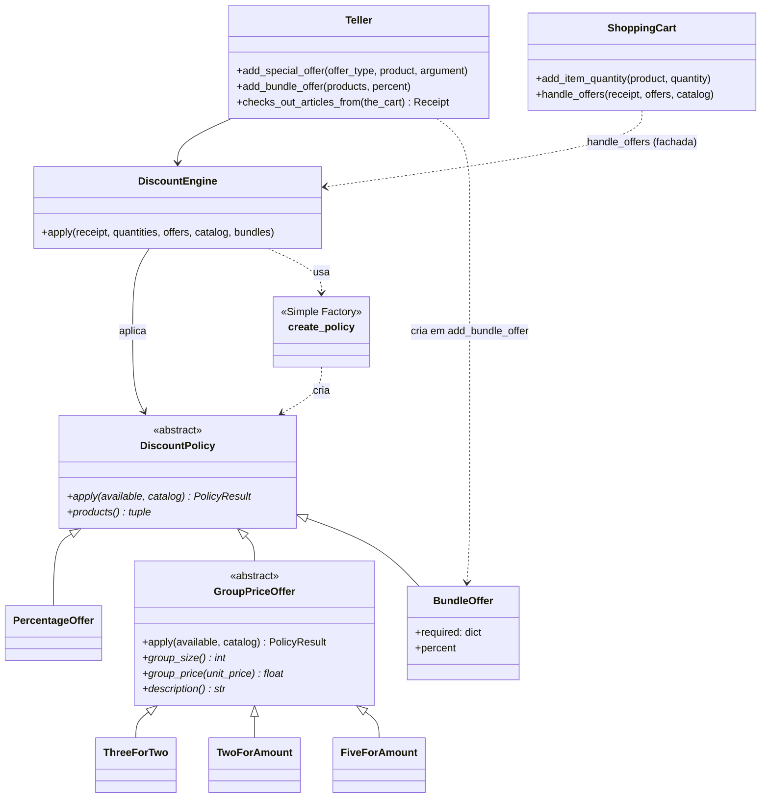

# Supermarket Receipt: Modernização de Sistema Legado

Trabalho prático da disciplina **Alta Qualidade de Software**, ministrada pelo professor Leonardo Cardia.

## Sumário

1. [Objetivo](#1-objetivo)
2. [Integrantes](#2-integrantes)
3. [Requisitos de ambiente](#3-requisitos-de-ambiente)
4. [Instalação](#4-instalação)
5. [Testes e cobertura](#5-testes-e-cobertura)
6. [Exemplo de uso](#6-exemplo-de-uso)
7. [Análise de segurança](#7-análise-de-segurança)
8. [Estrutura de pastas e documentos](#8-estrutura-de-pastas-e-documentos)
9. [Arquitetura e padrões de projeto](#9-arquitetura-e-padrões-de-projeto)
10. [Combos promocionais e decisões registradas](#10-combos-promocionais-e-decisões-registradas)
11. [Defeitos corrigidos](#11-defeitos-corrigidos)
12. [Lições aprendidas e limitações](#12-lições-aprendidas-e-limitações)
13. [Créditos e licença](#créditos-e-licença)

---

## 1. Objetivo

O Supermarket Receipt é um sistema legado que registra as compras de um supermercado, calcula preços e ofertas e emite o recibo. A equipe atuou como uma consultoria técnica contratada para modernizá-lo de forma incremental, sem alterar indevidamente o comportamento existente, e para implementar uma nova regra de negócio: **combos promocionais**, com 10% de desconto sobre os itens que formam combos completos.

O trabalho partiu da versão `python_pytest` do kata original, marcada neste repositório pela tag `legado-baseline`, e seguiu estas etapas:

1. **Diagnóstico técnico:** code smells, violações de SOLID e defeitos do legado, com os trechos de código correspondentes.
2. **Requisitos e plano de contingência:** requisitos funcionais e não funcionais com critérios de aceitação, riscos, invariantes de negócio e estratégia de reversão.
3. **Testes de caracterização:** uma suíte que fixou o comportamento existente antes de qualquer alteração no código.
4. **Refatoração com padrões de projeto:** Strategy, Template Method e Simple Factory, preservando as interfaces públicas.
5. **Correção de defeitos:** três defeitos do legado, corrigidos em commits isolados e documentados.
6. **Combos promocionais:** a nova modalidade de desconto, que convive com as ofertas existentes sem desconto duplicado.
7. **Análise de segurança:** Bandit, pip-audit e Safety, executados antes e depois da modernização.

---

## 2. Integrantes

- Felipe Nogueira
- Lucas Choucate
- Júlia Gaglianone
- Ramon Papes
- Suianne Martins

---

## 3. Requisitos de ambiente

| Item | Requisito |
|---|---|
| Python | **3.10 ou superior**, a versão mínima exigida pelo `pytest` 9.2.0 |
| Sistema operacional | Qualquer um que rode o Python 3.10 ou superior: Linux, macOS ou Windows |
| Git | Necessário para clonar o repositório |

O código de produção (`python_pytest/src/`) usa só a biblioteca padrão do Python. O `requirements.txt` declara apenas as ferramentas de teste, com as versões fixadas: `pytest` 9.2.0 e `coverage` 7.6.12.

Ambientes em que a suíte foi executada:

| Sistema operacional | Python | Resultado | Evidência |
|---|---|---|---|
| Linux | 3.14.6 | Todas as fases, da execução original aos combos | Logs [`01`](docs/evidencias/testes/01_pytest_inicial.log) a [`05`](docs/evidencias/testes/05_pytest_apos_combos.log) |
| Windows | 3.12.5 | 118 aprovados | [`06_pytest_final.log`](docs/evidencias/testes/06_pytest_final.log) |
| Linux (Ubuntu 24.04) | 3.10.21, 3.11.16, 3.12.3, 3.13.15 e 3.14.6 | 118 aprovados e 99% de cobertura em cada versão, seguindo este README em um clone limpo | [`07_execucao_independente.log`](docs/evidencias/testes/07_execucao_independente.log) |

---

## 4. Instalação

Depois de clonar o repositório, todos os comandos desta seção são executados na pasta `python_pytest/`.

### 4.1 Obter o código

```bash
git clone https://github.com/LucasChoucate/SupermarketReceipt-Refactoring-Kata.git
cd SupermarketReceipt-Refactoring-Kata/python_pytest
```

### 4.2 Criar o ambiente virtual e instalar as dependências

Linux e macOS:

```bash
python3 -m venv .venv
.venv/bin/python -m pip install --upgrade pip
.venv/bin/python -m pip install -r requirements.txt
```

Windows (PowerShell ou Prompt de Comando):

```powershell
python -m venv .venv
.venv\Scripts\python.exe -m pip install --upgrade pip
.venv\Scripts\python.exe -m pip install -r requirements.txt
```

Observações:

- **Nome do interpretador.** Use o comando que chama o Python 3.10 ou superior na sua máquina: em geral, `python3` no Linux e no macOS, e `python` ou o inicializador `py` no Windows. Confira a versão com `python3 --version` ou `python --version`. No macOS, o `python3` instalado com as Command Line Tools pode ser anterior ao 3.10; nesse caso, instale uma versão mais nova pelo [python.org](https://www.python.org/downloads/) ou pelo Homebrew.
- **Atualização do `pip`.** Versões do `pip` anteriores à 26.2.2 têm vulnerabilidades conhecidas (alertas A-02 e A-03 da [análise de segurança](docs/seguranca_antes_depois.md#6-classificação-dos-alertas)). Por isso o `pip` do ambiente é atualizado antes da instalação.
- **Sem ativar o ambiente.** Os comandos chamam o Python do ambiente virtual pelo caminho (`.venv/bin/python` ou `.venv\Scripts\python.exe`). Assim eles funcionam em qualquer terminal, inclusive no PowerShell com a política de execução padrão do Windows, que bloqueia o script de ativação. Quem preferir pode ativar o ambiente (`source .venv/bin/activate` ou `.venv\Scripts\Activate.ps1`) e usar só `python`.

### 4.3 Conferir a instalação

Linux e macOS:

```bash
.venv/bin/python -m pytest -q
```

Windows:

```powershell
.venv\Scripts\python.exe -m pytest -q
```

O resultado esperado é `118 passed`.

---

## 5. Testes e cobertura

Os comandos são executados na pasta `python_pytest/`, com o ambiente da [seção 4](#4-instalação) instalado.

Linux e macOS:

```bash
.venv/bin/python -m pytest -v
.venv/bin/python -m coverage run --branch --source=src -m pytest -q
.venv/bin/python -m coverage report -m
```

Windows:

```powershell
.venv\Scripts\python.exe -m pytest -v
.venv\Scripts\python.exe -m coverage run --branch --source=src -m pytest -q
.venv\Scripts\python.exe -m coverage report -m
```

O resultado esperado é **118 testes aprovados** e **99% de cobertura** de linhas e ramos em `src/`. As 3 linhas não cobertas ficam em `catalog.py`: são os métodos de `SupermarketCatalog`, que representam o acesso a um banco de dados fora do kata e só lançam uma exceção. Nos testes, eles são substituídos por um catálogo em memória. Para ver a cobertura linha a linha no navegador, gere o relatório em HTML (`.venv/bin/python -m coverage html` ou `.venv\Scripts\python.exe -m coverage html`) e abra o arquivo `htmlcov/index.html`.

| Arquivo em `tests/` | Testes | O que verifica |
|---|---|---|
| `test_supermarket.py` | 1 | O teste original do kata |
| `test_comportamento_legado.py` | 53 | Caracterização do legado: carrinho, cada oferta e seus limites, ofertas combinadas, recibo impresso e contratos das interfaces públicas |
| `test_recibos_de_referencia.py` | 14 | Texto completo do recibo de 7 carrinhos de referência, sem combos e com um combo de outros produtos cadastrado, que não pode alterar o recibo |
| `test_defeitos_corrigidos.py` | 8 | Comportamento corrigido dos defeitos DEF-01, DEF-02 e DEF-03 |
| `test_politicas_de_desconto.py` | 11 | Testes unitários das estratégias de desconto, do Template Method e da fábrica |
| `test_combos.py` | 31 | Regra dos combos: cenários do enunciado, excedentes, múltiplos combos, convivência com as ofertas e recibo |

Os demais arquivos da pasta dão suporte aos testes: `conftest.py` (produtos e preços usados nos cenários), `fake_catalog.py` (catálogo em memória), `receipt_printer.py` (impressão do recibo) e `auxiliares.py` (montagem de carrinhos).

A evolução da suíte em cada fase do trabalho, com os logs e os relatórios de cobertura, está em [`docs/evidencias_testes.md`](docs/evidencias_testes.md).

---

## 6. Exemplo de uso

O sistema não tem uma interface própria: ele é usado por outro código, como fazem os testes. O script [`exemplo_de_uso.py`](python_pytest/exemplo_de_uso.py) mostra esse uso fora do pytest. Ele cadastra três produtos, uma oferta de 20% na maçã e um combo de escova com creme dental, monta um carrinho e imprime o recibo.

Na pasta `python_pytest/`:

Linux e macOS:

```bash
.venv/bin/python exemplo_de_uso.py
```

Windows:

```powershell
.venv\Scripts\python.exe exemplo_de_uso.py
```

Saída esperada:

```text
escova                             20.00
  10.00 * 2
creme dental                       15.00
maca                                3.00
  2.00 * 1.500
20.0% off (maca)                   -0.60
combo 10% off (escova)             -1.00
combo 10% off (creme dental)       -1.50

Total:                             34.90
```

Como o recibo é calculado:

- **Combo:** o carrinho tem 2 escovas e 1 creme dental, o que forma 1 combo completo. O desconto é de 10% sobre R$ 25,00 (R$ 10,00 + R$ 15,00), dividido em uma linha por produto: −1,00 na escova e −1,50 no creme dental. A segunda escova não completa outro combo e é cobrada a preço cheio.
- **Oferta individual:** 1,5 kg de maçã a R$ 2,00/kg com 20% de desconto: −0,60.
- **Total:** 20,00 + 15,00 + 3,00 − 0,60 − 2,50 = 34,90.

O exemplo usa o catálogo em memória e a impressora de recibos de `tests/`, porque o catálogo real acessa um banco de dados que não faz parte do kata. O próprio script inclui `src/` e `tests/` no caminho de importação, então funciona da mesma forma em qualquer sistema operacional.

---

## 7. Análise de segurança

O código e as dependências foram analisados com três ferramentas, antes da modernização (tag `legado-baseline`) e depois dela:

| Ferramenta | O que analisa |
|---|---|
| **Bandit** | O código-fonte de `python_pytest/src/`, em busca de padrões de implementação inseguros |
| **pip-audit** | As dependências do `requirements.txt`, comparadas com a base pública de vulnerabilidades do PyPI e do OSV |
| **Safety** | As dependências do `requirements.txt` e o ambiente virtual do projeto, comparados com a base da Safety |

A análise completa, com a triagem de cada alerta, está em [`docs/seguranca_antes_depois.md`](docs/seguranca_antes_depois.md). Esta seção mostra como reproduzi-la e resume os resultados.

### 7.1 Ambiente separado para as ferramentas

As ferramentas ficam em um ambiente virtual próprio, **fora do repositório** (`../.venv-audit`), e não no `.venv` do projeto. Na primeira auditoria do grupo, elas foram instaladas no ambiente do projeto, e o `filelock`, que é dependência do próprio Safety, apareceu com 13 vulnerabilidades como se fosse do sistema auditado (alerta A-04). Com o ambiente separado, as ferramentas não contaminam o resultado e nenhuma dependência entra no projeto só por causa da auditoria.

Os comandos desta seção são executados na **raiz do repositório**, e não em `python_pytest/`. As versões são as mesmas da análise registrada.

Linux e macOS:

```bash
python3 -m venv ../.venv-audit
../.venv-audit/bin/python -m pip install bandit==1.9.4 pip-audit==2.10.1 safety==3.8.1
```

Windows:

```powershell
python -m venv ..\.venv-audit
..\.venv-audit\Scripts\python.exe -m pip install bandit==1.9.4 pip-audit==2.10.1 safety==3.8.1
```

### 7.2 Execução

Rode depois da instalação da [seção 4](#4-instalação), porque o Safety também analisa o ambiente `python_pytest/.venv`.

Linux e macOS:

```bash
../.venv-audit/bin/bandit -r python_pytest/src
../.venv-audit/bin/pip-audit -r python_pytest/requirements.txt
../.venv-audit/bin/safety auth login
../.venv-audit/bin/safety scan --target python_pytest
```

Windows:

```powershell
..\.venv-audit\Scripts\bandit.exe -r python_pytest/src
..\.venv-audit\Scripts\pip-audit.exe -r python_pytest/requirements.txt
..\.venv-audit\Scripts\safety.exe auth login
..\.venv-audit\Scripts\safety.exe scan --target python_pytest
```

Resultado esperado: o Bandit informa `No issues identified`, o pip-audit informa `No known vulnerabilities found` e o Safety não aponta nenhuma vulnerabilidade.

Observações:

- **Escopo do Bandit.** Só o código de produção (`src/`) é analisado. Em `tests/`, o Bandit aponta 86 usos de `assert` (B101), que são esperados, porque o `assert` é o mecanismo de verificação do pytest (alerta A-05).
- **pip-audit e internet.** O pip-audit instala as dependências do `requirements.txt` em um ambiente temporário para auditá-las, por isso precisa de acesso à internet.
- **O Safety exige conta.** Sem login, o `safety scan` só pergunta se você quer criar uma conta ou entrar em uma existente. O `safety auth login` abre o navegador para criar uma conta gratuita na Safety Platform ou entrar nela. Em terminais sem navegador, como o WSL ou uma sessão SSH, use `safety auth login --headless` e abra o endereço exibido em outro navegador. Na primeira execução, o `safety scan` pergunta se o projeto deve ser vinculado à conta e grava a resposta em `python_pytest/.safety-project.ini`, que o Git ignora. Ao iniciar, o Safety 3.8.1 exibe avisos de depreciação (`AuthlibDeprecationWarning`), que não afetam o resultado.
- **A política do Safety fica na conta.** As regras que ignoram certas ocorrências vêm da configuração da conta, e não de um arquivo do repositório. Outra conta pode ter outra política e, portanto, outro resultado.
- **Os resultados mudam com o tempo.** As bases de vulnerabilidades são atualizadas continuamente, então uma execução futura pode apontar vulnerabilidades novas nas mesmas versões.
- **Evidências oficiais.** Os comandos acima mostram o resultado no terminal. Os relatórios registrados ficam em [`docs/evidencias/seguranca/`](docs/evidencias/seguranca/) e foram gerados com os comandos da [seção 2.3 do documento de segurança](docs/seguranca_antes_depois.md#23-comandos-executados). Não grave a saída nessas pastas, para não sobrescrever as evidências.

### 7.3 Resultados antes e depois

| Ferramenta | Antes (`legado-baseline`) | Depois |
|---|---|---|
| Bandit | 0 ocorrências em 5 arquivos e 133 linhas | 0 ocorrências em 7 arquivos e 349 linhas |
| pip-audit | 0 vulnerabilidades em 22 pacotes | 0 vulnerabilidades em 6 pacotes |
| Safety | 3 ocorrências, ignoradas pela política da conta: `pytest` sem versão fixada (A-01) e duas no `pip` 26.1.2 do ambiente (A-02 e A-03) | 0 ocorrências |

| Ação | Efeito |
|---|---|
| Fixar as versões no `requirements.txt` (`pytest==9.2.0` e `coverage==7.6.12`) | Resolveu o A-01 e tornou a instalação reproduzível |
| Remover o `approvaltests` e o `pytest-approvaltests`, que nenhum teste usava (decisão D7) | Os pacotes auditados caíram de 22 para 6 |
| Atualizar o `pip` do ambiente do projeto (passo da [seção 4.2](#42-criar-o-ambiente-virtual-e-instalar-as-dependências)) | Resolveu o A-02 e o A-03 |
| Isolar as ferramentas em `../.venv-audit` | Eliminou o falso positivo do `filelock` (A-04) |

Ressalvas:

- **Um alerta não é, por si só, uma vulnerabilidade explorável.** Cada ocorrência foi investigada quanto à origem, à versão e ao contexto. Nenhuma afetava o código de produção: todas estavam em ferramentas de desenvolvimento ou no ambiente.
- **A ausência de alertas não prova que o sistema é seguro.** O Bandit procura padrões conhecidos de código inseguro e não detecta erros de lógica de negócio, como os defeitos DEF-01 e DEF-02. O pip-audit e o Safety só conhecem as vulnerabilidades já publicadas nas suas bases.
- **Nenhuma dependência foi adicionada para gerar resultados nas ferramentas.**
- **Risco remanescente:** os valores monetários continuam em `float`, mantido para não alterar os valores observados (RNF09). Os riscos e as limitações estão na [seção 10 do documento de segurança](docs/seguranca_antes_depois.md#10-riscos-remanescentes-e-limitações).

---

## 8. Estrutura de pastas e documentos

```text
.
├── README.md                        este documento
├── license.txt                      licença MIT do kata original
├── apresentacao/                    slides da apresentação
├── docs/
│   ├── diagnostico_tecnico.md       code smells, SOLID e defeitos do legado
│   ├── registro_de_defeitos.md      DEF-01 a DEF-03: causa, impacto e correção
│   ├── requisitos.md                RF, RNF, critérios de aceitação e rastreabilidade
│   ├── plano_contingencia.md        riscos, invariantes, interfaces e reversão
│   ├── plano_de_execucao.md         fases do trabalho, passo a passo
│   ├── padroes_projeto.md           padrões, diagramas antes e depois e SOLID
│   ├── seguranca_antes_depois.md    Bandit, pip-audit e Safety: triagem e comparação
│   ├── evidencias_testes.md         evolução da suíte e comparação antes e depois
│   └── evidencias/
│       ├── pytest_antes_ubuntu.log  os 57 testes de caracterização iniciais
│       ├── testes/                  logs do pytest e cobertura de cada fase
│       └── seguranca/
│           ├── antes/               relatórios na tag legado-baseline
│           └── depois/              relatórios após a modernização
└── python_pytest/                   estrutura original do kata, preservada
    ├── README.md                    descrição original da versão Python do kata
    ├── requirements.txt             pytest e coverage, com versões fixadas
    ├── pytest.ini                   inclui src/ e tests/ no caminho de importação
    ├── exemplo_de_uso.py            recibo de exemplo, fora do pytest (seção 6)
    ├── src/                         código de produção
    │   ├── catalog.py               contrato do catálogo de produtos
    │   ├── discount_engine.py       aplica ofertas e combos na ordem de menor total
    │   ├── discount_policies.py     estratégias de desconto, combos e fábrica
    │   ├── model_objects.py         produtos, ofertas e descontos
    │   ├── receipt.py               recibo: itens, descontos e total
    │   ├── shopping_cart.py         carrinho de compras
    │   └── teller.py                caixa: ofertas, combos e checkout
    └── tests/                       118 testes e arquivos de apoio (seção 5)
```

A estrutura sugerida na seção 7 do edital é ilustrativa. A pasta original do kata (`python_pytest/`) foi preservada, para manter a compatibilidade com a execução e os testes, e os arquivos de teste sugeridos (`test_comportamento_legado.py` e `test_combos.py`) existem com esses nomes. Os documentos estão em Markdown, que o GitHub exibe formatado e cujas mudanças ficam visíveis no histórico.

Onde está cada entregável do edital:

| Entregável | Onde está |
|---|---|
| 5.1 Relatório de diagnóstico técnico | [`docs/diagnostico_tecnico.md`](docs/diagnostico_tecnico.md). Os defeitos encontrados estão detalhados em [`docs/registro_de_defeitos.md`](docs/registro_de_defeitos.md) |
| 5.2 Documento de requisitos | [`docs/requisitos.md`](docs/requisitos.md) |
| 5.3 Plano de contingência e refatoração | [`docs/plano_contingencia.md`](docs/plano_contingencia.md). A execução, fase a fase, está em [`docs/plano_de_execucao.md`](docs/plano_de_execucao.md) |
| 5.4 Código refatorado | [`python_pytest/src/`](python_pytest/src/) |
| 5.5 Padrões de projeto | [`docs/padroes_projeto.md`](docs/padroes_projeto.md) |
| 5.6 Promoção de combos | `BundleOffer` em [`discount_policies.py`](python_pytest/src/discount_policies.py), `Teller.add_bundle_offer` em [`teller.py`](python_pytest/src/teller.py) e a convivência com as ofertas em [`discount_engine.py`](python_pytest/src/discount_engine.py). Testes em [`test_combos.py`](python_pytest/tests/test_combos.py) |
| 5.7 Testes automatizados | [`python_pytest/tests/`](python_pytest/tests/), descritos na [seção 5](#5-testes-e-cobertura) |
| 5.8 Análise de segurança | [`docs/seguranca_antes_depois.md`](docs/seguranca_antes_depois.md) e [`docs/evidencias/seguranca/`](docs/evidencias/seguranca/) |
| 5.9 Evidências, README e organização | Este README, [`docs/evidencias_testes.md`](docs/evidencias_testes.md) e [`docs/evidencias/`](docs/evidencias/) |
| 5.10 Apresentação | [`apresentacao/`](apresentacao/) |

Os documentos também cobrem os elementos da documentação simplificada inspirada no MPS.BR (seção 6 do edital): contexto e diagnóstico, no diagnóstico técnico e no registro de defeitos; requisitos, no documento de requisitos; riscos e contingência, no plano de contingência; testes e validação, nas evidências de testes; padrões e arquitetura, no documento de padrões de projeto; segurança, na análise de segurança; e lições aprendidas, na [seção 12](#12-lições-aprendidas-e-limitações) deste README.

---

## 9. Arquitetura e padrões de projeto

### 9.1 O problema do legado

No legado, o método `ShoppingCart.handle_offers()` calculava sozinho todas as ofertas, com uma cadeia de condicionais sobre o tipo da oferta. A fórmula das ofertas por grupo estava copiada três vezes, com os defeitos DEF-01 e DEF-02 junto, e qualquer modalidade nova, como os combos, exigiria alterar esse método. A análise completa está no [diagnóstico técnico](docs/diagnostico_tecnico.md).

### 9.2 Padrões adotados

| Padrão | Onde | Problema que resolve |
|---|---|---|
| **Strategy** | `DiscountPolicy` e suas subclasses `PercentageOffer`, `GroupPriceOffer` e `BundleOffer`, em `discount_policies.py` | Cada tipo de oferta virou uma classe com o próprio cálculo, no lugar da cadeia de condicionais. Os combos entraram como uma estratégia nova, sem alterar as existentes |
| **Template Method** | `GroupPriceOffer.apply()`, com os ganchos `group_size()`, `group_price()` e `description()` implementados por `ThreeForTwo`, `TwoForAmount` e `FiveForAmount` | As três fórmulas copiadas viraram um único algoritmo, e os defeitos DEF-01 e DEF-02 passaram a ser corrigidos em um só lugar |
| **Simple Factory** | `create_policy(offer)`, em `discount_policies.py` | Traduz o `SpecialOfferType` da interface pública para a estratégia correspondente, sem nenhum `if` por tipo de oferta |

Os dois padrões exigidos pelo edital são atendidos pelo Strategy e pelo Template Method. A fábrica é chamada de *Simple Factory*, e não de *Factory Method* do GoF, porque é uma função com um dicionário, e não uma hierarquia de classes criadoras.

Completam a estrutura:

- o **`DiscountEngine`** (`discount_engine.py`), que aplica as estratégias em sequência, controla as unidades já consumidas por cada uma e decide entre ofertas e combos ([seção 10.2](#102-convivência-com-as-ofertas-existentes));
- o **`ShoppingCart.handle_offers()`**, mantido como fachada de compatibilidade: a assinatura é a mesma, e o cálculo é delegado ao `DiscountEngine`.

### 9.3 Diagrama de classes



Os métodos marcados com `*` são abstratos. Os diagramas completos de antes e depois, os trechos de código antes e depois e os testes de cada padrão estão em [`docs/padroes_projeto.md`](docs/padroes_projeto.md#2-diagramas-de-classes).

### 9.4 Princípios SOLID

| Princípio | Como aparece no código |
|---|---|
| SRP | O carrinho só guarda produtos e quantidades. Cada estratégia calcula um tipo de desconto, e o `DiscountEngine` orquestra as estratégias |
| OCP | Os combos entraram como uma classe nova: o `discount_policies.py` ganhou 46 linhas e não perdeu nenhuma. O engine mudou, porque a convivência entre combos e ofertas é uma regra nova de orquestração ([demonstração](docs/padroes_projeto.md#9-demonstração-de-extensibilidade-os-combos)) |
| LSP | O engine aplica qualquer `DiscountPolicy` da mesma forma. O `BundleOffer`, criado depois, é aplicado pelo mesmo código que as ofertas antigas |
| ISP | A `DiscountPolicy` tem só dois métodos. Os ganchos das ofertas por grupo ficam em `GroupPriceOffer`, e não na interface geral |
| DIP | O engine depende da abstração `DiscountPolicy`, e o `Teller` depende só do contrato de `SupermarketCatalog` (correção do DEF-03). A inversão não é completa: o `Teller` cria o engine e os combos diretamente, para preservar o construtor `Teller(catalog)` ([limitações](docs/padroes_projeto.md#10-limitações)) |

### 9.5 Interfaces públicas preservadas

A refatoração e os combos não mudaram nenhuma interface pública existente: `Teller(catalog)`, `add_special_offer()`, `checks_out_articles_from()`, `product_with_name()` e `offers`; os métodos e propriedades de `ShoppingCart`, incluindo o `handle_offers()`; o `Receipt`; e o `SpecialOfferType`, com os mesmos membros e valores. Os testes de contrato da caracterização protegem essas interfaces, e a lista completa está no [plano de contingência](docs/plano_contingencia.md#3-interfaces-que-devem-permanecer-compatíveis). Tudo o que foi criado é aditivo, como o `Teller.add_bundle_offer()`.

---

## 10. Combos promocionais e decisões registradas

### 10.1 A regra dos combos

Um combo é cadastrado com a lista dos seus produtos. Um produto repetido na lista significa que o combo exige mais de uma unidade dele, e o percentual padrão é 10%:

```python
teller.add_bundle_offer([escova, creme_dental])
```

O desconto incide só sobre as unidades que formam combos completos:

```text
nº de combos = menor valor de ⌊quantidade no carrinho ÷ quantidade exigida⌋ entre os produtos do combo
desconto     = 10% × nº de combos × soma dos preços dos produtos do combo
```

Com a escova a R$ 10,00 e o creme dental a R$ 15,00, os cenários do edital ficam assim:

| Carrinho | Combos | Desconto | Total |
|---|---|---|---|
| 1 escova + 1 creme dental | 1 | R$ 2,50 | R$ 22,50 |
| 2 escovas + 1 creme dental | 1 | R$ 2,50 | R$ 32,50 (a segunda escova a preço cheio) |
| 2 escovas + 2 cremes dentais | 2 | R$ 5,00 | R$ 45,00 |
| Só 1 escova | 0 | nenhum | R$ 10,00 |

No recibo, cada produto do combo gera uma linha de desconto com a descrição `combo 10% off` (decisão D4). Nos produtos vendidos por peso, só a parte inteira da quantidade forma combos.

### 10.2 Convivência com as ofertas existentes

Um produto pode ter uma oferta individual, como o "3 por 2", e também fazer parte de um combo. Cada unidade recebe no máximo um desconto, mas dar sempre prioridade ao combo encareceria alguns carrinhos. Com a escova em "3 por 2", o carrinho de 3 escovas e 1 creme dental custa R$ 35,00 com a oferta; se o combo usar 1 escova e 1 creme, as 2 escovas restantes não ativam o "3 por 2", e o total sobe para R$ 42,50.

Por isso o `DiscountEngine` calcula o carrinho de duas formas e fica com a de menor total (decisão D1):

- **Ordem C (ofertas primeiro):** as ofertas individuais são aplicadas como seriam sem combos, e os combos usam só as unidades que sobraram.
- **Ordem B (combos primeiro):** os combos são aplicados primeiro, e as ofertas individuais usam só as unidades que sobraram.

Os totais são comparados em centavos, para que erros de arredondamento não decidam a escolha. Em empate, vence a ordem C, e as ofertas preexistentes continuam no recibo.

| Escova (R$ 10,00) com | Carrinho | Ordem C | Ordem B | Escolhida |
|---|---|---|---|---|
| "3 por 2" | 3 escovas + 1 creme | **R$ 35,00** | R$ 42,50 | C: a oferta |
| 20% de desconto | 1 escova + 1 creme | R$ 23,00 | **R$ 22,50** | B: o combo |
| "5 por R$ 40,00" | 5 escovas + 5 cremes | R$ 115,00 | **R$ 112,50** | B: o combo |
| "2 por R$ 15,00" | 2 escovas + 2 cremes | R$ 45,00 | R$ 45,00 | C: empate, fica a oferta |

O que essa política garante:

- **Cadastrar um combo nunca encarece o carrinho.** O resultado nunca é maior que o da ordem C, e a ordem C só acrescenta descontos ao cálculo sem combos.
- **Não há desconto duplicado**, porque cada unidade é consumida por uma única estratégia.
- **Um carrinho sem combo completo gera o mesmo recibo** que geraria sem combos cadastrados.
- **O recibo só muda quando o combo traz ganho real** para o cliente.

Limitação: a escolha vale para o carrinho inteiro. Distribuições mistas, como um combo primeiro e outra oferta primeiro no mesmo carrinho, não são testadas, porque isso exigiria avaliar todas as combinações. O detalhamento está no [plano de execução](docs/plano_de_execucao.md#política-de-convivência-entre-combos-e-ofertas).

### 10.3 Decisões registradas

| ID | Decisão | Escolha |
|---|---|---|
| D1 | Convivência entre combo e oferta | A ordem de menor total entre ofertas primeiro (C) e combos primeiro (B), comparada em centavos. Em empate, ficam as ofertas |
| D2 | Defeitos do legado | Corrigir os três ([seção 11](#11-defeitos-corrigidos)) |
| D3 | Momento e forma das correções | Depois da refatoração estrutural, em uma branch própria, com um commit `fix:` por defeito, cada um precedido de um teste `xfail(strict=True)` do comportamento correto |
| D4 | Combo no recibo | Um `Discount` por produto do combo, com a descrição `combo 10% off`. O `Discount` e o `ReceiptPrinter` não mudam |
| D5 | API do combo | Nova e aditiva: `Teller.add_bundle_offer(products, percent=10)`. O `SpecialOfferType`, o `Teller.offers` e o `add_special_offer()` não mudam |
| D6 | Dois combos disputando o mesmo produto | Vence o combo cadastrado primeiro |
| D7 | Biblioteca `approvaltests` | Removida: nenhum teste a usava, e a remoção reduziu os pacotes auditados de 22 para 6 |

As justificativas de cada decisão estão no [plano de contingência](docs/plano_contingencia.md#8-decisões-registradas).

---

## 11. Defeitos corrigidos

Os testes de caracterização e o diagnóstico revelaram três defeitos no legado. A equipe decidiu corrigir todos (D2). As correções foram feitas depois da refatoração estrutural, para separar mudança de estrutura de mudança de comportamento (D3). Cada uma tem um commit `fix:` próprio, precedido de um teste do comportamento correto marcado com `xfail(strict=True)`, que falhava enquanto o defeito existia.

| ID | Defeito | Severidade | Exemplo | Legado | Corrigido | Commit |
|---|---|---|---|---|---|---|
| DEF-01 | No "2 por valor" com quantidade ímpar, a unidade que sobra era cobrada duas vezes (divisão `/` no lugar de `//`) | Alta: a oferta encarecia a compra | 3 escovas a R$ 10,00 em "2 por R$ 15,00" | R$ 32,50, mais que os R$ 30,00 sem a oferta | R$ 25,00 | `a16de14` |
| DEF-02 | Nas ofertas por grupo, a fração de produtos vendidos por peso saía de graça | Média: desconto maior que o anunciado | 3,5 kg de maçã a R$ 2,00/kg em "3 por 2" | R$ 4,00 | R$ 5,00 | `d06abcc` |
| DEF-03 | `Teller.product_with_name()` usava o atributo `products`, que não faz parte do contrato de `SupermarketCatalog` | Baixa: latente, porque o catálogo dos testes tinha o atributo | Catálogo que implementa só o contrato | `AttributeError` | Funciona | `11c4b76` |

Com o Template Method, o DEF-01 e o DEF-02 foram corrigidos em um único método, o `GroupPriceOffer.apply()`. No legado, o DEF-02 estava repetido em três blocos de código.

As correções mudaram de propósito **7 casos de teste** (3 do DEF-01 e 4 do DEF-02) e acrescentaram 1 teste para o DEF-03. Todos os outros testes continuaram com os mesmos valores esperados. Os casos alterados estão nas [evidências de testes](docs/evidencias_testes.md#6-casos-alterados-de-propósito), e a causa, o impacto e a correção de cada defeito, no [registro de defeitos](docs/registro_de_defeitos.md).

---

## 12. Lições aprendidas e limitações

### 12.1 Lições aprendidas

- **Caracterizar antes de refatorar revelou defeitos.** O único teste original cadastrava um desconto para a escova, mas só colocava maçãs no carrinho, e não detectava nenhum dos três defeitos. Ao fixar o comportamento de cada oferta, os testes de caracterização mostraram valores que contrariavam a regra de negócio, como o "2 por valor" que cobrava mais do que sem a oferta (DEF-01) e a fração de produto por peso que saía de graça (DEF-02). Registrar o comportamento correto em testes `xfail(strict=True)` transformou cada defeito em um teste que falhava até ser corrigido.
- **Separar refatoração de correção torna cada mudança verificável.** O PR da refatoração não alterou nenhum teste existente, e os testes dos defeitos continuaram falhando, o que provou que a estrutura mudou sem mudar o comportamento. O PR das correções mostrou só os 7 valores alterados de propósito, e cada correção pode ser revertida sozinha.
- **Um padrão se justifica pelo problema que resolve.** O Template Method transformou um defeito repetido em três blocos de código em uma correção de um só método. O Strategy permitiu acrescentar os combos sem remover nenhuma linha das estratégias existentes.
- **Uma regra nova precisa de uma política explícita de convivência com as antigas.** Dar sempre prioridade ao combo encarecia alguns carrinhos, e comparar só os percentuais das ofertas levava a escolhas erradas. A solução foi calcular as duas ordens e testar uma propriedade, "cadastrar um combo nunca encarece o carrinho", além dos exemplos.
- **Ferramentas de auditoria precisam de um ambiente isolado, e cada alerta precisa de triagem.** As 13 vulnerabilidades do `filelock` eram da própria ferramenta, e não do projeto. Na reavaliação, uma primeira tentativa fixou o `pytest` em 8.3.5, uma versão dentro da faixa vulnerável, e o alerta, que antes era ignorado pela política, passou a contar como ocorrência. Fixar a versão só resolve quando a versão escolhida está fora da faixa.
- **Menos dependências significam menos superfície de ataque.** O `approvaltests` não era usado por nenhum teste, mas trazia a maior parte das dependências. Removê-lo reduziu os pacotes auditados de 22 para 6.
- **A reprodutibilidade depende de detalhes do ambiente.** Redirecionar a saída do Safety com `>` escondeu a pergunta interativa da primeira execução, e no PowerShell ainda gravou o arquivo em UTF-16. O comando do Python muda entre sistemas (`python3` ou `python`), e o PowerShell bloqueia o script de ativação do ambiente virtual por padrão. Por isso o README chama o Python do ambiente pelo caminho e traz os comandos de cada sistema.

### 12.2 Limitações

- **Valores monetários em `float`.** O tipo foi mantido para não alterar os valores observados pelos testes (RNF09). O recibo arredonda para 2 casas, e a escolha entre ofertas e combos compara os totais em centavos, mas a imprecisão do `float` continua sendo um risco remanescente.
- **A política de combos decide pelo carrinho inteiro.** Ela compara duas ordens de aplicação, e não todas as distribuições possíveis entre ofertas e combos.
- **Limites das ferramentas de segurança.** O Safety exige conta e aplica uma política guardada na nuvem. O pip-audit e o Safety só conhecem vulnerabilidades já publicadas, e nenhuma das três ferramentas analisa o sistema em execução.
- **Evidências de ambientes diferentes.** Os logs foram gerados em máquinas diferentes, com Linux e Windows e versões diferentes do Python. A comparação entre eles vale pelas contagens de testes e pela cobertura, e não pelo tempo de execução.

---

## Créditos e licença

Este trabalho parte do [Supermarket Receipt Refactoring Kata](https://github.com/emilybache/SupermarketReceipt-Refactoring-Kata), criado por Emily Bache e distribuído sob a licença MIT, cujo texto está em [`license.txt`](license.txt). O enunciado original do kata está no repositório de origem, e a descrição da versão Python, em [`python_pytest/README.md`](python_pytest/README.md).
