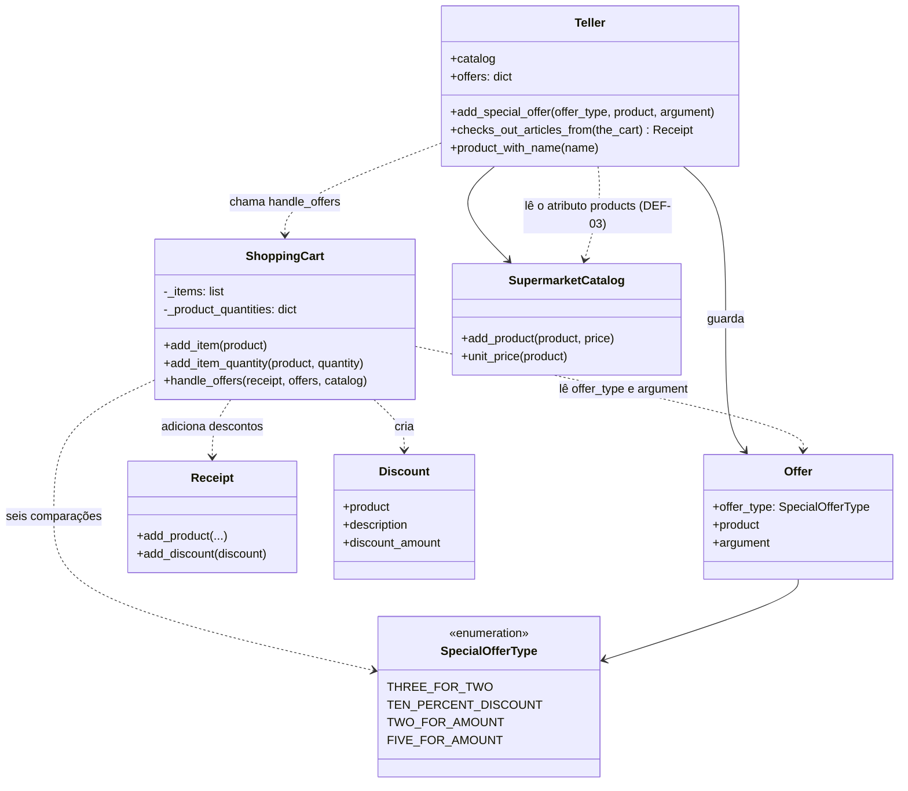
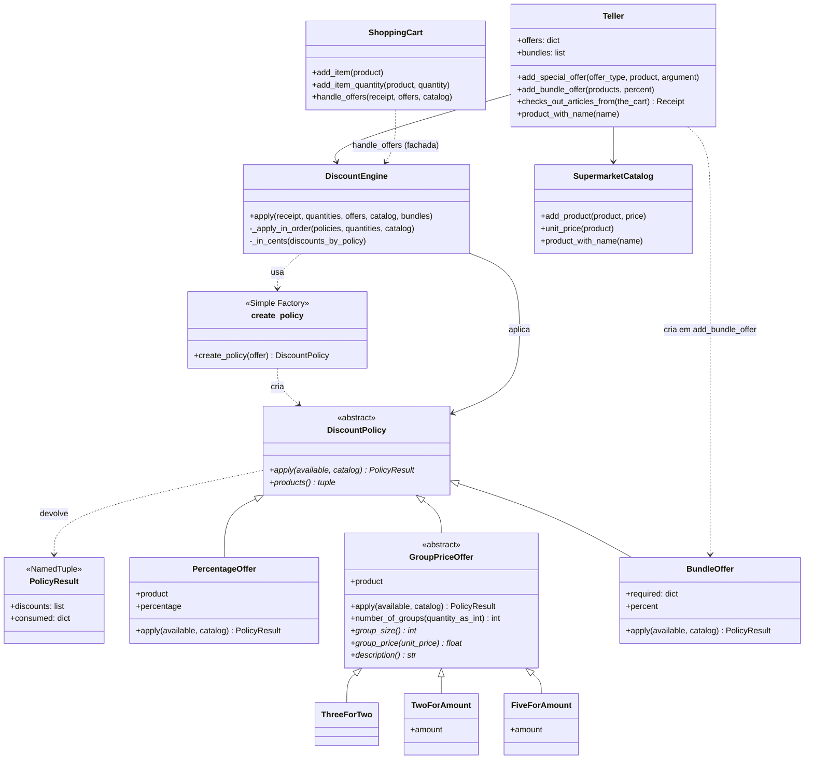

# Padrões de Projeto e Princípios SOLID

## Sumário

1. [Visão geral](#1-visão-geral)
2. [Diagramas de classes](#2-diagramas-de-classes)
3. [Strategy](#3-strategy)
4. [Template Method](#4-template-method)
5. [Simple Factory](#5-simple-factory)
6. [Fachada de compatibilidade](#6-fachada-de-compatibilidade)
7. [Princípios SOLID](#7-princípios-solid)
8. [O Template Method nas correções de defeitos](#8-o-template-method-nas-correções-de-defeitos)
9. [Demonstração de extensibilidade: os combos](#9-demonstração-de-extensibilidade-os-combos)
10. [Limitações](#10-limitações)

> As referências ao código "antes" valem para a tag `legado-baseline` (commit `58df732`). As referências ao código "depois" valem para a `develop` após a Fase 7 (commit `39ee13a`). Todos os caminhos são relativos a `python_pytest/`.

---

## 1. Visão geral

A refatoração tirou o cálculo dos descontos do método `ShoppingCart.handle_offers()` e o distribuiu em três padrões que trabalham juntos:

| Padrão | Problema que resolve | Onde está |
|---|---|---|
| **Strategy** | Um único método calculava todas as ofertas com uma cadeia de condicionais | `DiscountPolicy` e suas subclasses, em `src/discount_policies.py` |
| **Template Method** | A mesma fórmula das ofertas por grupo estava copiada três vezes, com os defeitos junto | `GroupPriceOffer.apply()`, em `src/discount_policies.py` |
| **Simple Factory** | A escolha do cálculo pelo `offer_type` estava espalhada em seis comparações | `create_policy()`, em `src/discount_policies.py` |

Um quarto elemento, o `DiscountEngine` (`src/discount_engine.py`), aplica as estratégias em sequência e decide entre ofertas e combos. O `ShoppingCart.handle_offers()` continua existindo como fachada de compatibilidade (ver a [seção 6](#6-fachada-de-compatibilidade)).

A refatoração foi feita em passos pequenos, um commit por passo, com a suíte de caracterização passando a cada commit (PR #6, branch `refactor/politicas-desconto`):

| Commit | Passo |
|---|---|
| `ce2b634` | Renomeia variáveis e extrai um método por tipo de oferta |
| `7ffdf7c` | Introduz `DiscountPolicy` (Strategy) e `PercentageOffer` |
| `cb2b8b0` | Extrai `GroupPriceOffer` (Template Method) para as ofertas por grupo |
| `f40fbc9` | Cria as políticas a partir de `SpecialOfferType` com uma Simple Factory |
| `b09778d` | Move a aplicação dos descontos para `DiscountEngine` |
| `bc68a4e` | Faz as políticas informarem as unidades consumidas |

---

## 2. Diagramas de classes

### 2.1 Antes

Todo o cálculo está em `ShoppingCart.handle_offers()`, que lê os dados de `Offer` e decide sozinho como tratar cada `SpecialOfferType`.



### 2.2 Depois

Cada tipo de oferta é uma estratégia. As ofertas por grupo compartilham o algoritmo de `GroupPriceOffer`. O `DiscountEngine` só conhece a abstração `DiscountPolicy`.



O `Offer`, o `SpecialOfferType`, o `Receipt` e o `Discount` continuam como estavam e foram omitidos do diagrama "depois". Os métodos marcados com `*` são abstratos.

---

## 3. Strategy

### 3.1 Problema

O `handle_offers()` reunia o cálculo das quatro ofertas em um método de 39 linhas, com uma cadeia de condicionais sobre o `offer_type`. O [diagnóstico técnico](diagnostico_tecnico.md) apontou, nesse mesmo método:

- [Long Method (3.1)](diagnostico_tecnico.md#31-long-method): identificação, verificação e cálculo de todas as ofertas no mesmo lugar;
- [Switch Statements (3.2)](diagnostico_tecnico.md#32-switch-statements): `if`/`elif` misturados com `if` independentes, testando o mesmo `offer_type` em pontos diferentes;
- [Feature Envy (3.5)](diagnostico_tecnico.md#35-feature-envy): o carrinho usava muito mais os dados de `Offer`, do catálogo e do recibo do que os seus próprios;
- [Data Class (3.6)](diagnostico_tecnico.md#36-data-class): o `Offer` guardava os dados, mas não tinha comportamento.

### 3.2 Solução

Cada tipo de oferta virou uma classe que implementa a interface `DiscountPolicy`. O código que usa a estratégia chama sempre os mesmos dois métodos, sem saber qual oferta está calculando.

| Papel no padrão | Classe |
|---|---|
| Interface da estratégia | `DiscountPolicy` (`apply` e `products`) |
| Estratégias concretas | `PercentageOffer`, `ThreeForTwo`, `TwoForAmount`, `FiveForAmount` e `BundleOffer` |
| Contexto | `DiscountEngine` |

Além de devolver os descontos, cada estratégia informa as unidades que **consumiu** (`PolicyResult.consumed`). É isso que permite ao engine aplicar uma oferta e um combo no mesmo carrinho sem dar dois descontos para a mesma unidade (ver a [política de convivência](plano_contingencia.md#22-regras-de-convivência-entre-combos-e-ofertas)).

### 3.3 Código antes e depois

**Antes:** a escolha e o cálculo estão misturados no método do carrinho.

```python
# src/shopping_cart.py (legado), trechos das linhas 39–65
if offer.offer_type == SpecialOfferType.THREE_FOR_TWO:
    x = 3
elif offer.offer_type == SpecialOfferType.TWO_FOR_AMOUNT:
    x = 2
    if quantity_as_int >= 2:
        total = offer.argument * (quantity_as_int / x) + quantity_as_int % 2 * unit_price
        ...
if offer.offer_type == SpecialOfferType.FIVE_FOR_AMOUNT:
    x = 5
...
if offer.offer_type == SpecialOfferType.TEN_PERCENT_DISCOUNT:
    discount = Discount(p, str(offer.argument) + "% off",
                        -quantity * unit_price * offer.argument / 100.0)
```

**Depois:** a interface e uma estratégia concreta.

```python
# src/discount_policies.py, linhas 15–49
class DiscountPolicy(ABC):
    """Strategy for calculating the discounts of a special offer."""

    @abstractmethod
    def apply(self, available, catalog):
        """Return a PolicyResult for the quantities in ``available``. ..."""

    @abstractmethod
    def products(self):
        """Products this policy can discount."""


class PercentageOffer(DiscountPolicy):
    def apply(self, available, catalog):
        quantity = available[self.product]
        unit_price = catalog.unit_price(self.product)
        amount = -quantity * unit_price * self.percentage / 100.0
        discount = Discount(self.product, str(self.percentage) + "% off", amount)
        return PolicyResult([discount], {self.product: quantity})
```

O contexto aplica qualquer estratégia da mesma forma, sem nenhum `if` sobre o tipo da oferta:

```python
# src/discount_engine.py, método _apply_in_order
for policy in policies:
    ...
    result = policy.apply(available, catalog)
    discounts[policy] = result.discounts
    for product, quantity in result.consumed.items():
        available[product] -= quantity
```

### 3.4 Testes que exercitam o padrão

| Teste | O que mostra |
|---|---|
| `test_desconto_percentual_consome_todas_as_unidades` (`test_politicas_de_desconto.py`) | Uma estratégia testada isoladamente, sem carrinho nem `Teller` |
| `test_oferta_por_grupo_consome_so_os_grupos_completos` (3 casos) | Cada estratégia informa as unidades que consumiu |
| `test_oferta_por_grupo_nao_ativada_nao_gera_desconto_nem_consome` | Uma oferta que não ativa não gera desconto nem consome unidades |
| `test_combos.py` | O `BundleOffer`, estratégia nova, aplicado pelo mesmo contexto |
| `test_comportamento_legado.py` e `test_recibos_de_referencia.py` | A troca da estrutura não mudou o resultado das ofertas preexistentes |

---

## 4. Template Method

### 4.1 Problema

As três ofertas por grupo ("3 por 2", "2 por valor" e "5 por valor") usam a mesma fórmula: *número de grupos × preço do grupo + unidades que sobram × preço unitário*. No legado, ela estava escrita três vezes, com variações que não eram intencionais. O diagnóstico registrou:

- [Duplicação de código (3.3)](diagnostico_tecnico.md#33-duplicação-de-código): a mesma fórmula nas linhas 45, 54–55 e 63–64, com três nomes diferentes para o resultado;
- [Lógica do "3 por 2" dividida em dois blocos (3.4)](diagnostico_tecnico.md#34-lógica-do-3-por-2-dividida-em-dois-blocos): o tamanho do grupo definido em um ponto e o desconto calculado em outro;
- [Números mágicos (3.9)](diagnostico_tecnico.md#39-números-mágicos): o tamanho do grupo repetido como literal em vários pontos.

A consequência mais grave é que **os defeitos também foram copiados**: o DEF-02 estava nas três cópias (ver a [seção 8](#8-o-template-method-nas-correções-de-defeitos)).

### 4.2 Solução

A classe abstrata `GroupPriceOffer` define o algoritmo uma única vez, no método `apply()`. As subclasses só preenchem os três pontos que variam, os "ganchos":

| Gancho | `ThreeForTwo` | `TwoForAmount` | `FiveForAmount` |
|---|---|---|---|
| `group_size()` | 3 | 2 | 5 |
| `group_price(unit_price)` | `2 * unit_price` | `self.amount` | `self.amount` |
| `description()` | `"3 for 2"` | `"2 for " + amount` | `"5 for " + amount` |

### 4.3 Código antes e depois

**Antes:** três cópias da fórmula.

```python
# src/shopping_cart.py (legado)
# "2 por valor": linha 45
total = offer.argument * (quantity_as_int / x) + quantity_as_int % 2 * unit_price
# "3 por 2": linhas 54–55
discount_amount = quantity * unit_price - (
            (number_of_x * 2 * unit_price) + quantity_as_int % 3 * unit_price)
# "5 por valor": linhas 63–64
discount_total = unit_price * quantity - (
            offer.argument * number_of_x + quantity_as_int % 5 * unit_price)
```

**Depois:** um algoritmo e três subclasses pequenas.

```python
# src/discount_policies.py, linhas 64–97
class GroupPriceOffer(DiscountPolicy):
    def apply(self, available, catalog):
        """Template method: charge each complete group at the group price and the rest at full price."""
        quantity = available[self.product]
        quantity_as_int = int(quantity)
        if quantity_as_int < self.group_size():
            return PolicyResult([], {})
        unit_price = catalog.unit_price(self.product)
        number_of_groups = self.number_of_groups(quantity_as_int)
        remainder = quantity - number_of_groups * self.group_size()
        price_with_offer = number_of_groups * self.group_price(unit_price) + remainder * unit_price
        discount_amount = quantity * unit_price - price_with_offer
        discount = Discount(self.product, self.description(), -discount_amount)
        return PolicyResult([discount], {self.product: number_of_groups * self.group_size()})

    @abstractmethod
    def group_size(self): ...
    @abstractmethod
    def group_price(self, unit_price): ...
    @abstractmethod
    def description(self): ...


# src/discount_policies.py, linhas 99–109
class ThreeForTwo(GroupPriceOffer):
    def group_size(self):
        return 3

    def group_price(self, unit_price):
        return 2 * unit_price

    def description(self):
        return "3 for 2"
```

A condição de ativação (`quantity_as_int < self.group_size()`) agora deriva do tamanho do grupo. No legado, ela era escrita à parte em cada oferta (`> 2`, `>= 2`, `>= 5`).

### 4.4 Testes que exercitam o padrão

| Teste | O que mostra |
|---|---|
| `test_nova_oferta_por_grupo_reaproveita_o_algoritmo_comum` (`test_politicas_de_desconto.py`) | O teste cria uma oferta fictícia, `QuatroPorTres`, que implementa **só os três ganchos**, e ela funciona sem nenhuma alteração em `GroupPriceOffer` |
| `test_oferta_por_grupo_consome_so_os_grupos_completos` (3 casos) | O mesmo algoritmo atende às três ofertas reais |
| `test_dois_por_valor_com_quantidade_impar_cobra_sobra_a_preco_cheio` e `test_promocao_por_grupo_cobra_a_fracao_restante` (`test_defeitos_corrigidos.py`) | As correções feitas no algoritmo comum valem para todas as ofertas por grupo |

---

## 5. Simple Factory

### 5.1 Problema

No legado, o `offer_type` era comparado seis vezes ao longo do `handle_offers()` ([Switch Statements, 3.2](diagnostico_tecnico.md#32-switch-statements)). Depois da Strategy, ainda era preciso traduzir o tipo público da oferta (`SpecialOfferType`, que faz parte da interface e não pode mudar) na estratégia certa. Sem uma fábrica, essa tradução voltaria a ser uma cadeia de `if` dentro do engine.

### 5.2 Solução

Uma *Simple Factory*: um dicionário que associa cada `SpecialOfferType` à função que cria a estratégia correspondente. O nome correto é Simple Factory, e não o padrão GoF *Factory Method*, porque não há hierarquia de criadores, só uma função.

```python
# src/discount_policies.py, linhas 182–194
# Simple Factory: translates the public SpecialOfferType into a strategy.
# A new kind of offer only needs a new policy class and one entry here.
_POLICY_BY_OFFER_TYPE = {
    SpecialOfferType.THREE_FOR_TWO: lambda offer: ThreeForTwo(offer.product),
    SpecialOfferType.TEN_PERCENT_DISCOUNT: lambda offer: PercentageOffer(offer.product, offer.argument),
    SpecialOfferType.TWO_FOR_AMOUNT: lambda offer: TwoForAmount(offer.product, offer.argument),
    SpecialOfferType.FIVE_FOR_AMOUNT: lambda offer: FiveForAmount(offer.product, offer.argument),
}


def create_policy(offer):
    """Create the discount policy that implements ``offer``."""
    return _POLICY_BY_OFFER_TYPE[offer.offer_type](offer)
```

A fábrica também é o único lugar que interpreta o `Offer.argument`, cujo significado depende do tipo da oferta ([Primitive Obsession, 3.7](diagnostico_tecnico.md#37-primitive-obsession)). Cada estratégia recebe o valor já com o nome certo (`percentage` ou `amount`), e o `ThreeForTwo` simplesmente não o recebe.

O `BundleOffer` **não** passa pela fábrica. Os combos não entraram no `SpecialOfferType` de propósito (decisão D5 do [plano de contingência](plano_contingencia.md#8-decisões-registradas)), para não alterar o enum público. Eles são criados pelo `Teller.add_bundle_offer()`.

### 5.3 Testes que exercitam o padrão

| Teste | O que mostra |
|---|---|
| `test_fabrica_cria_a_politica_de_cada_tipo_de_oferta` (4 casos, `test_politicas_de_desconto.py`) | Cada `SpecialOfferType` gera a estratégia certa, com o produto certo |
| `test_fabrica_atende_todos_os_tipos_de_oferta` | Percorre o enum inteiro. Se um tipo novo for criado sem a entrada correspondente na fábrica, o teste falha |

---

## 6. Fachada de compatibilidade

O `ShoppingCart.handle_offers()` faz parte da interface do legado, e o [plano de contingência](plano_contingencia.md#3-interfaces-que-devem-permanecer-compatíveis) exige mantê-la. Por isso o método não foi apagado: virou uma fachada de uma linha que delega o cálculo ao engine.

```python
# src/shopping_cart.py, linhas 35–41
def handle_offers(self, receipt, offers, catalog):
    """Add to ``receipt`` the discounts of ``offers``.

    Kept for compatibility with the legacy interface; the calculation
    is done by DiscountEngine.
    """
    DiscountEngine().apply(receipt, self._product_quantities, offers, catalog)
```

O `Teller` não usa mais esse método: ele chama o `DiscountEngine` diretamente, passando também os combos.

---

## 7. Princípios SOLID

A tabela compara a situação apontada na [seção 4.6 do diagnóstico](diagnostico_tecnico.md#46-síntese-da-análise-solid) com a situação depois da refatoração.

| Princípio | Antes | Depois |
|---|---|---|
| SRP | Violação em `ShoppingCart.handle_offers()` | Atendido |
| OCP | Violação em `handle_offers()` e `SpecialOfferType` | Atendido nas estratégias. O engine mudou para receber os combos (ver a [seção 9](#9-demonstração-de-extensibilidade-os-combos)) |
| LSP | Sem violação concreta | Atendido, e verificado por testes |
| ISP | Sem violação concreta | Mantido |
| DIP | Violação em `Teller.product_with_name()` (DEF-03) | Corrigido no catálogo. O engine depende da abstração, com as ressalvas da [seção 10](#10-limitações) |

### 7.1 SRP: Responsabilidade Única

**Antes** ([diagnóstico, 4.1](diagnostico_tecnico.md#41-srp-single-responsibility-principle-princípio-da-responsabilidade-única)): o `ShoppingCart` guardava os itens **e** calculava todas as ofertas.

**Depois:** cada classe tem um motivo para mudar.

| Classe | Responsabilidade |
|---|---|
| `ShoppingCart` | Guardar os produtos e as quantidades. O `handle_offers()` só delega |
| `PercentageOffer`, `ThreeForTwo`, `TwoForAmount`, `FiveForAmount`, `BundleOffer` | Calcular um tipo de desconto |
| `GroupPriceOffer` | A fórmula comum das ofertas por grupo |
| `create_policy` | Traduzir o `SpecialOfferType` em uma estratégia |
| `DiscountEngine` | Aplicar as estratégias em sequência, controlar as unidades já consumidas e escolher entre ofertas e combos |
| `Teller` | Registrar as ofertas e os combos e montar o recibo |

Mudar a regra do "3 por 2" só mexe em `ThreeForTwo`. Mudar a política de convivência entre ofertas e combos só mexe no `DiscountEngine`.

### 7.2 OCP: Aberto/Fechado

**Antes** ([diagnóstico, 4.2](diagnostico_tecnico.md#42-ocp-openclosed-principle-princípio-abertofechado)): incluir uma oferta exigia alterar o `handle_offers()`, aumentando a cadeia de condicionais.

**Depois:**
- **Uma nova oferta por grupo** é uma subclasse de `GroupPriceOffer` com três ganchos, mais uma entrada na fábrica. O teste `test_nova_oferta_por_grupo_reaproveita_o_algoritmo_comum` mostra isso com o `QuatroPorTres`, sem nenhuma alteração no algoritmo.
- **Os combos** entraram como uma estratégia nova (`BundleOffer`) **sem alterar nenhuma linha das estratégias existentes nem da fábrica**. O engine, porém, precisou mudar, porque a convivência entre combos e ofertas é uma regra nova de orquestração. Os números estão na [seção 9](#9-demonstração-de-extensibilidade-os-combos).

### 7.3 LSP: Substituição de Liskov

O `DiscountEngine` trata todas as estratégias da mesma forma: chama `products()` e `apply()` e usa o `PolicyResult` devolvido. Qualquer subclasse de `DiscountPolicy` pode ocupar o lugar de outra, desde que respeite o contrato:
- devolver um `PolicyResult`;
- não consumir mais unidades do que as disponíveis em `available`;
- não gerar desconto quando a oferta não ativa.

O `BundleOffer` é a prova prática: foi adicionado depois e é aplicado pelo mesmo código que as ofertas antigas. O teste `test_fabrica_atende_todos_os_tipos_de_oferta` verifica que toda estratégia criada pela fábrica é uma `DiscountPolicy`, e os testes de consumo verificam o contrato das unidades.

No catálogo, o diagnóstico ([4.3](diagnostico_tecnico.md#43-lsp-liskov-substitution-principle-princípio-da-substituição-de-liskov)) não encontrou violação concreta. A correção do DEF-03 reforçou a substituição: o teste `test_product_with_name_funciona_com_qualquer_catalogo_do_contrato` usa um catálogo que implementa só o contrato, e o `Teller` funciona com ele.

### 7.4 ISP: Segregação de Interfaces

O diagnóstico ([4.4](diagnostico_tecnico.md#44-isp-interface-segregation-principle-princípio-da-segregação-de-interfaces)) não encontrou violação. A refatoração manteve as interfaces enxutas:
- A `DiscountPolicy` tem só dois métodos, e o engine usa os dois.
- Os ganchos `group_size`, `group_price` e `description` ficam em `GroupPriceOffer`, e não na interface geral. Por isso o `PercentageOffer` e o `BundleOffer` não são obrigados a implementar métodos de grupo que não fazem sentido para eles.
- O `SupermarketCatalog` ganhou só o `product_with_name()`, que o `Teller` usa.

### 7.5 DIP: Inversão de Dependência

**Antes** ([diagnóstico, 4.5](diagnostico_tecnico.md#45-dip-dependency-inversion-principle-princípio-da-inversão-de-dependência)): o `Teller.product_with_name()` acessava o atributo `products`, que só existia no `FakeCatalog` (DEF-03).

**Depois:**
- **Catálogo:** a busca por nome entrou no contrato do `SupermarketCatalog`, e o `Teller` passou a depender só dele (commit `11c4b76`, [registro de defeitos, 3.3](registro_de_defeitos.md#33-def-03-busca-por-nome-no-contrato-do-catálogo)).
- **Descontos:** o algoritmo do `DiscountEngine` depende da abstração `DiscountPolicy`, e não dos tipos concretos. Os tipos concretos só aparecem na fábrica e no `Teller.add_bundle_offer()`.

A inversão não é completa, e as ressalvas estão na [seção 10](#10-limitações).

---

## 8. O Template Method nas correções de defeitos

A [decisão D3](plano_contingencia.md#8-decisões-registradas) separou a refatoração da correção dos defeitos: primeiro a estrutura mudou com o comportamento preservado, inclusive os defeitos, e só depois os defeitos foram corrigidos, em uma branch própria. O Template Method fez cada correção caber em um único lugar.

### 8.1 DEF-02: fração gratuita nas ofertas por grupo

O defeito ([registro, DEF-02](registro_de_defeitos.md#def-02-fração-gratuita-nas-ofertas-por-grupo)) calculava a sobra com `quantity_as_int`, de modo que a fração de produtos vendidos por peso saía de graça.

| | Antes da refatoração | Depois da refatoração |
|---|---|---|
| Onde estava o defeito | Três trechos do `handle_offers()`: linhas 45, 54–55 e 63–64 | Uma linha do `GroupPriceOffer.apply()` |
| Correção | Três alterações, uma em cada cópia da fórmula | **Uma linha**, que vale para as três ofertas (commit `d06abcc`) |

```diff
# src/discount_policies.py, commit d06abcc
-        # DEF-02 (legacy): the remainder ignores the fraction of products sold by weight.
-        remainder = quantity_as_int % self.group_size()
+        remainder = quantity - number_of_groups * self.group_size()
```

### 8.2 DEF-01: "2 por valor" com quantidade ímpar

O defeito ([registro, DEF-01](registro_de_defeitos.md#def-01-2-por-valor-com-quantidade-ímpar)) só existia na cópia do "2 por valor", que usava divisão real (`/`) no número de grupos. Durante a refatoração, ele foi preservado como uma sobrescrita do gancho `number_of_groups()` em `TwoForAmount`. A correção foi **apagar essa sobrescrita**, e o "2 por valor" passou a usar a divisão inteira da classe base, como as outras ofertas (commit `a16de14`):

```diff
# src/discount_policies.py, commit a16de14
-    def number_of_groups(self, quantity_as_int):
-        # DEF-01 (legacy): real division ("/") instead of integer division ("//").
-        return quantity_as_int / self.group_size()
```

Os dois defeitos foram corrigidos sem tocar em mais nenhuma classe. Cada correção é um commit isolado, que pode ser revertido sozinho se necessário.

---

## 9. Demonstração de extensibilidade: os combos

A funcionalidade de combos (Fase 5, PR #8) foi o teste real da estrutura nova. O diagnóstico já a citava como o exemplo de que, no legado, uma nova modalidade exigiria alterar a lógica existente ([4.2](diagnostico_tecnico.md#42-ocp-openclosed-principle-princípio-abertofechado)).

Alterações no `src/` entre o início e o fim da Fase 5 (`git diff --numstat 0a4b8a9 5640f31 -- python_pytest/src`):

| Arquivo | Linhas adicionadas | Linhas removidas | O que mudou |
|---|---|---|---|
| `discount_policies.py` | 46 | **0** | Nova classe `BundleOffer`. Nenhuma estratégia existente nem a fábrica foram tocadas |
| `discount_engine.py` | 39 | 10 | Novo parâmetro `bundles`, cálculo nas duas ordens (ofertas primeiro e combos primeiro), escolha da mais barata em centavos e omissão de linhas de desconto vazias |
| `teller.py` | 18 | 1 | Novo método `add_bundle_offer()`, a lista `bundles` e o repasse dos combos ao engine |
| `shopping_cart.py`, `model_objects.py`, `receipt.py`, `catalog.py` | 0 | 0 | Nenhuma alteração |
| **Total** | **103** | **11** | |

**Leitura dos números:**
- **As estratégias ficaram fechadas para modificação.** O combo é uma estratégia nova, ao lado das antigas, sem nenhuma linha removida ou alterada em `discount_policies.py`.
- **A interface pública não mudou.** O `SpecialOfferType`, o `Teller.offers` e o `add_special_offer()` ficaram como estavam (decisão D5), o que o teste `test_add_bundle_offer_nao_altera_as_ofertas_nem_o_enum` verifica. O parâmetro `bundles` do engine tem valor padrão, então a fachada `handle_offers()` continuou funcionando sem alteração.
- **O engine precisou mudar, e isso era esperado.** Os combos são a primeira estratégia que disputa unidades com outra, e a regra para resolver essa disputa ([decisão D1](plano_contingencia.md#8-decisões-registradas)) é responsabilidade de quem orquestra, não de cada estratégia. As 10 linhas removidas pertencem ao próprio engine: a assinatura do `apply()`, o tipo de retorno do `_apply_in_order()`, que passou de lista para dicionário por estratégia, e as docstrings correspondentes. Graças ao `PolicyResult.consumed`, criado na refatoração, o engine já sabia controlar as unidades consumidas.
- **Toda a suíte anterior continuou passando sem nenhuma alteração.** Na Fase 5, a única mudança nos testes foi a criação do `test_combos.py` (ver o log [`05_pytest_apos_combos.log`](evidencias/testes/05_pytest_apos_combos.log)).

---

## 10. Limitações

- **DIP incompleto.** O `DiscountEngine` importa a função `create_policy`, que conhece as classes concretas, e o `Teller` cria o `DiscountEngine` e o `BundleOffer` diretamente, sem receber essas dependências de fora. Injetar as dependências exigiria mudar o construtor `Teller(catalog)`, que faz parte da interface pública que o [plano de contingência](plano_contingencia.md#3-interfaces-que-devem-permanecer-compatíveis) manda preservar. Para o tamanho do projeto, a troca não compensaria.
- **A fábrica precisa de uma entrada por tipo novo.** Uma nova oferta exige uma classe e uma linha no `_POLICY_BY_OFFER_TYPE`. É uma alteração pequena e localizada, e o teste `test_fabrica_atende_todos_os_tipos_de_oferta` falha se ela for esquecida. Mas não é extensão sem nenhuma modificação.
- **O `Offer.argument` continua genérico.** A fábrica isola a interpretação do argumento, mas o `Offer` e o `SpecialOfferType` foram mantidos por fazerem parte da interface pública ([Primitive Obsession, 3.7](diagnostico_tecnico.md#37-primitive-obsession)).
- **O `float` continua sendo usado para dinheiro.** Os padrões não mudam o tipo dos valores. O risco está registrado no [diagnóstico (3.11)](diagnostico_tecnico.md#311-float-para-valores-monetários) e na [análise de segurança](seguranca_antes_depois.md#101-riscos-remanescentes). O engine compara os totais em centavos para que a escolha entre ofertas e combos não dependa de erros de arredondamento.
